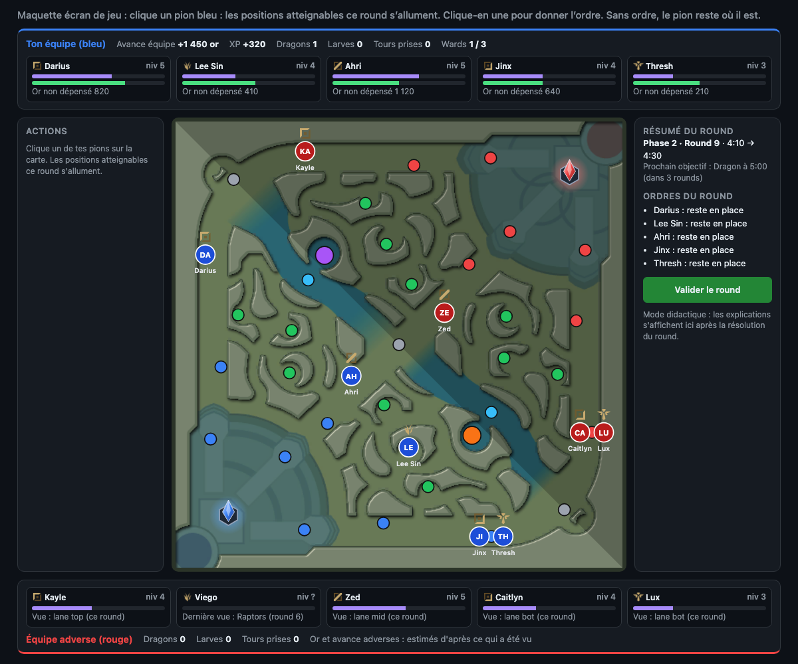

# League Macro Learner

A lightweight, turn-based web game for practicing **macro decision-making in League of Legends**: lane priority, rotations, objective control and map awareness.

> Status: early game design. The rules below are a first sketch and will be refined.



## The idea

Each team is five tokens on a simplified Summoner's Rift: top, jungle, mid, ADC and support. Every turn, both sides secretly give an order to each of their five tokens, then the turn resolves at the same time for everyone, like simultaneous-move chess.

> *Recall top, jungle takes Herald, mid rotates to Herald, bot lane shifts mid.*

The goal is to learn to read the board: who has lane priority, who can rotate first, and which objective is worth contesting.

## Tempo

Tempo is the heart of the game. **Every round is a unit of time, and the team that wastes fewer rounds wins.**

- **Priority is tempo.** A laner who has pushed their wave is free to move this round. Their opponent has to stay and catch the wave, or lose gold and XP.
- **Every action has a time cost.** A recall, a death or a long walk across the map costs rounds. Recalling right after shoving a wave costs almost nothing, while recalling with the wave pushed in front of your tower costs a lot.
- **Arriving first wins.** When both teams move toward the same objective, the side that gets there first, or with more tokens, takes the fight or the objective.
- **Converting tempo.** A tempo lead only matters once you spend it on something: an objective, a tower, an invade or vision.

Teaching mode calls out tempo directly, for example: *"You lost 2 rounds: your mid recalled without pushing the wave."* *(design call)* These tempo costs come from a rule table in data (situation → rounds lost + explanation), checked against the round's events, not from simulating alternative plays.

## Core rules (draft)

- **Random draft.** Each game starts with a random draft of real champions for both teams.
- **Matchups matter.** Each lane matchup gives an advantage that changes across five stages of the game: *really early, early, mid, mid-late, late*. That advantage drives lane priority.
- **Map positions.** The map has 39 positions: each lane tower (T1, T2, T3) and lane middle, every jungle camp, the Baron and Dragon pits, both Scuttle Crabs, and the two bases. They are placed from real Summoner's Rift coordinates, on top of the official minimap from CommunityDragon.
- **Rounds.** A round is resolved once you have given and confirmed an order for each of your five champions.
- **Phases.** Neutral objectives (Scuttle Crab, Dragons, Voidgrubs, Herald, Baron) set the rhythm. The game is split into phases, and rounds cover less game time early and more game time later. Most of the advantage is decided before 25 minutes, so a game stops at 25:10, after 37 rounds.

| Phase | Game time | Round length | Rounds | Key events |
|---|---|---|---|---|
| 1. Level 1 & first clear | 1:30 → 3:30 | 20 s | 6 | lane priority, invades, end of first clear |
| 2. Scuttles & first Dragon | 3:30 → 6:10 | 20 s | 8 | Scuttle Crabs, first Dragon, Voidgrubs spawn |
| 3. Voidgrubs & plates | 6:10 → 14:10 | 40 s | 12 | Voidgrubs, Dragons, tower plates |
| 4. Herald & mid game | 14:10 → 20:10 | 1 min | 6 | plates drop, Herald, T1/T2 towers |
| 5. Baron | 20:10 → 25:10 | 1 min | 5 | Baron, Dragon Soul, T2/inhibitor towers |

The longer a round, the farther a token can move during it. Objective timers change between patches, so they live in data files.

- **Verdict.** There is no nexus to destroy for now. At the end of the game, the winner is the team with the bigger accumulated advantage: gold, objectives and towers.
- **Starting state.** Every token starts in lane, and you know which camp the enemy jungler starts on.
- **Death and recall.** A token that dies or recalls comes back next turn at a base position on its own half of the map. On that turn it can't invade or take an objective. In late game, a death also costs one extra turn.

## Fights

**Contact.** A contact happens when enemy champions end the round on the same position. Only the arrival position counts, so champions who cross paths during the round don't meet.

When a contact happens, resolution pauses and each player involved chooses to **fight** or **flee**, with a default already selected. Against the AI, the AI answers for its side. A round therefore has two steps: give the orders, then answer the contacts.

| Situation | Default choice |
|---|---|
| Even numbers in lane (1v1, 2v2) | **Trade**: spells are exchanged without going for the kill. Nobody dies. Matchup and lead decide who wins the trade, which moves the wave and the lead gauge. |
| Ganked (the enemy arrives outnumbering you) | **Flee** |
| The ganker | Asked to choose: commit to the fight or not |
| Neutral objective with an enemy already there | Asked to choose: fight or flee |

- **Flee**: the champion survives and goes back to its previous position. On an objective, it gives the objective up.
- **Fight**: the winner takes the objective or the kill. Losers **die**.
- If both sides flee, nobody takes the objective and it stays up for the next round. If one side flees and the other fights, the fighting side takes it without a fight.

**Invading** enemy jungle is a commitment, with no option to flee. If you meet an enemy and lose the fight, you die.

**Towers in a dive.** A fight on a position with a standing tower counts that tower as an extra **weak champion** on the defending side.

**Who wins.** Fights are **deterministic**: the same situation always gives the same result. In order of weight:

1. **Numbers**: the side with more champions has the upper hand, especially in early game.
2. **Lead**: a per-champion gauge of XP and gold, updated each round.
3. **Matchup**: the advantage of one champion against another, which depends on the game stage.
4. **Skirmish strength** or **teamfight strength**: a per-champion value that also depends on the game stage. A fight with **7 or more champions in total** (4v3 or bigger) is a teamfight. Anything smaller, up to 3v3, is a skirmish.

Game stages for matchups, skirmish and teamfight: *really early, early, mid, mid-late, late*.

**How the factors combine** *(design call, to tune in playtest)*. Each side gets a fight score, which is a weighted sum. Numbers carry by far the biggest weight, and that weight is highest in early game. Lead, matchup and skirmish or teamfight strength come after. In a fight with more than one champion per side, each matchup term is the average over the opposing champions that have a matchup row. All weights live in data.

- **The side with the higher score wins.** Every losing champion dies. Winners gain gold and XP for each kill.
- **On an exact tie**, nobody dies and both sides go back to their previous position.

## Lanes and towers

**Waves.** Each lane has a wave position: near the blue tower, in the middle, or near the red tower. The wave state is **deterministic**, like a fight:

- When both laners stay in lane, the matchup and the lead decide where the wave goes.
- When one side gets more champions in the lane, the wave is pushed.
- When a laner leaves their lane, their wave pushes toward their tower and the enemy laner gains lead. If that enemy also had matchup pressure, the tower loses some HP.
- *(design call)* "Near the tower" always means the side's **frontmost standing tower** in that lane. When a T1 falls, the wave fights at the T2.

**Towers.** Each tower has **5 HP**, and one HP is one plate.

- Each round of pushing on a tower removes HP based on how many champions push it:

  | Champions pushing | 1 | 2 | 3 | 4 | 5 |
  |---|---|---|---|---|---|
  | HP removed | 1 | 1 | 2 | 3 | 4 |

- The **Herald** removes **3 HP**.
- *(design call)* A tower only takes damage when the attacking side's wave is near it and at least one attacker is on its position. Defenders on the position fight the attackers first.
- *(design call)* There are no inhibitors or nexus as targets in this version, since the game stops at 25:10.
- **Voidgrubs** and **Baron** multiply tower damage (see [Neutral objectives](#neutral-objectives)).
- Plates give gold until 14:00.

## Neutral objectives

| Objective | Reward |
|---|---|
| **Scuttle Crab** | Gold for the champion who takes it, plus vision of the nearby pit (Dragon for the bottom Scuttle, Baron for the top one) This vision lasts like a normal ward and does not count toward the 3-ward limit. |
| **Dragon** | Lead for the whole team |
| **Voidgrubs** | Tower damage ×1.5 for the team, for the rest of the game |
| **Herald** | Picked up by the champion who takes it, then launched on a tower in a later round to remove 3 HP |
| **Baron** | Tower damage ×2 for the team for 3 rounds |

Tower damage bonuses stack: Voidgrubs plus Baron gives ×3. The Herald launch is an action the carrier picks at its tower position.

*(design calls, values in data)*
- Each objective has a minimum number of champions needed to take it. Starting values: 1 for Scuttle, Dragon, Voidgrubs and Herald, 3 for Baron.
- **Dragon, Voidgrubs, Herald and Baron take time.** You arrive on the pit one round and take the objective at the end of the next round, as long as you stay there. With **4 or more champions** on the pit, Dragon, Voidgrubs and Herald are taken on arrival. Baron always takes the extra round, even with 5 champions. In between, the enemy has a round to contest it. The Scuttle Crab is taken on arrival.
- Voidgrubs, Herald and Baron follow their real spawn timers from the current patch, stored in data. They share the Baron pit, each one replacing the previous.
- There is no Dragon Soul bonus. Each Dragon simply adds team lead.
- Jungle camps respawn on their real timers and give gold and XP to whoever clears them. `clearSpeed` sets how many camps a jungler can clear in one round.

## Lead, gold and recall

Each champion has a **lead gauge** made of two parts:

- **XP**: updated at the end of every round, from farming, kills and objectives.
- **Items**: gold piles up as you play, but it only turns into power when you **recall** and buy items.

*(design call)* The gauge is a single number: XP value plus the value of the items you own. Unspent gold is shown separately and only adds to the gauge on recall. Farming each round, kills, camps, plates and objectives all give XP and/or gold, with amounts in data.

**End-of-game verdict** *(design call)*: each team scores its gold (including the value of items) plus fixed values for each objective and each tower plate or tower. The values live in data. The higher score wins.

Recalling is how you **cash in** your advantage. A champion sitting on a lot of gold is weaker than its gold says until it goes back to base. Picking the right moment to recall is a tempo decision: it costs rounds, but it turns gold into strength.

## Movement

The map positions form a graph, and a move is one step on it. Starting values:

- **Laners**: 1 move per round. Going from a lane to another lane, or to a Scuttle, counts as 1 move.
- **Junglers**: 2 moves per round. For example, Raptors → Krugs, Raptors → mid lane, or Raptors → enemy Blue Buff.

- **Camps and Scuttle** are taken by ending the move on their position. **Pit objectives** (Dragon, Voidgrubs, Herald, Baron) take one extra round, unless 4 or more champions are on them (except Baron, which always takes the extra round) (see [Neutral objectives](#neutral-objectives)).
- **Recall** keeps the champion in place for the round, and it respawns at a base position the next round, so a recall costs 1 round.
- **Bases** are two more positions (Base blue and Base red), which brings the total to 39. *(design call)* A champion who respawns after death or recall picks a starting point: a laner picks the frontmost standing tower of the lane they choose, and a jungler picks a camp on their own side.

These values live in data files and are a starting point, to be tuned through playtesting. That includes whether longer rounds give more moves.

## Vision

Enemy champions are hidden in fog of war. You see an enemy champion only if it is:

- in the **same lane** as one of your champions, meaning any tower position or the middle of that lane,
- on the **same position** as one of your champions (a camp, a pit, a Scuttle…),
- on a position where you have a **ward**.

Vision is revealed when the round resolves, so you use what you saw this round to plan the next one. The enemy jungler's starting camp is visible only during the first round.

**Wards**

- A champion can place a ward in addition to its move, **either on its starting position or on its arrival position** (the player chooses).
- Each team can place up to **3 wards per round**.
- A ward placed in round N gives vision when round N+1 resolves, then fades once round N+1 is confirmed.
- First round: depending on their starting side, the jungler can place their ward at the **Blue Buff** or at the **Raptors**.

**Clearing wards**

- Only the **jungler** and the **support** can clear wards.
- Each team can clear **1 ward per round**, either on the champion's starting position or on its arrival position (the player chooses).
- A champion can place a ward and clear one in the same round, on the same position or not.

## Game screen

- **Top**: your team's status. Team lead (gold and XP), Dragons, Voidgrubs, towers taken, wards used this round (x/3). One card per champion with role icon, name, level, XP bar, lead bar and unspent gold.
- **Center**: a flat map showing every playable position, with a tooltip on hover. One token per champion, with the official League role icon above it (from CommunityDragon) and its name below. Fog of war covers what you can't see.
- **Left panel, actions**: the selected token's options. Place a ward or clear one, each on the starting or arrival position. Recall.
- **Right panel, round summary**: current phase, round and game time, next objective spawn, the list of this round's orders, the **Confirm round** button, the fight or flee prompts when a contact happens during resolution, and teaching-mode explanations after the round resolves.
- **Bottom**: the enemy team, with the same layout, showing only what has been seen: where each champion was last seen and on which round, plus estimated gold and lead.
- **Giving orders**: click a token, and only the positions it can reach this round light up. Then click its next position. A dashed arrow shows the move. A token with no order stays where it is.

The clickable mockup [`docs/game-screen-mockup.html`](docs/game-screen-mockup.html) is the reference for this layout. It also holds the first draft of the position coordinates and the movement graph.

## Game modes

1. **vs AI.** A full game against a computer opponent. This is the first mode to build.
2. **vs human.** Two players give their orders simultaneously.
3. **Puzzles.** A preset mid-game situation where you have to find the winning play.
4. **Sandbox.** Set up any situation by hand: pick each champion, place it on any position, and set levels and advantages. It is meant for coaches, who can use it to explain a situation and then play it out.

**Teaching mode** can be turned on or off. When it is on, the game explains each turn's outcome, for example: *"The enemy mid had priority and rotated to Scuttle first, so it became a 2v1."*

## AI opponent

There are **10 difficulty levels**, named after League ranks: Iron, Bronze, Silver, Gold, Platinum, Emerald, Diamond, Master, Grandmaster, Challenger.

The AI always plays by the fog-of-war rules: it only knows what its own wards and champions see. Lower levels don't play at random. They make the **macro mistakes typical of their rank**, and higher levels make them less and less often. Challenger almost always plays the best tempo move, but even Master+ makes a small mistake now and then.

Each level is a data profile with a frequency per mistake (for example, Iron greeds 60% of the time and Challenger 1%). Mistakes are random rolls, but fights and waves stay deterministic.

| Mistake | What it looks like | Iron–Bronze | Silver–Gold | Plat–Emerald | Diamond | Master+ |
|---|---|---|---|---|---|---|
| **Greed / overextend** | Stays shoved with no vision, keeps pushing a tower with the enemy missing | very often | often | sometimes | rarely | very rarely |
| **Objective timing** | Shows up late to a spawn, starts it without priority, forgets respawn timers | very often | often | sometimes | rarely | very rarely |
| **Pointless plays** | Fights or invades when nothing is up on the map | very often | often | sometimes | rarely | very rarely |
| **Chasing kills** | Picks fight over flee when outnumbered | very often | often | sometimes | rarely | very rarely |
| **Rotating without priority** | Leaves lane to help without the wave pushed | often | often | sometimes | rarely | very rarely |
| **Bad recall** | Recalls with the wave crashing into its own tower, right before a spawn, or sits on gold | often | often | sometimes | rarely | very rarely |
| **Poor vision** | Few wards, wards in useless spots, never clears wards | very often | often | sometimes | rarely | very rarely |
| **No conversion** | Wins a fight, then walks away without taking a tower or objective | often | sometimes | sometimes | rarely | very rarely |
| **Ignoring the enemy jungler** | Plays the same way whether or not the jungler was last seen nearby | very often | often | sometimes | rarely | very rarely |

Master, Grandmaster and Challenger keep a small mistake rate that goes down with each rank, and they also differ in how many rounds ahead they plan.

*(design call)* The AI is **rule-based**. It uses a library of macro heuristics (contest objectives with priority, recall on a shoved wave, track the jungler, convert leads) plus a board evaluation function, and each mistake is a switch on those rules. Master+ adds a shallow look-ahead of 1–2 rounds on its own candidate moves, without a full game-tree search.

## Data model

All values that are scored from 0–10 or -5 to +5 come as five numbers, one per game stage: *really early, early, mid, mid-late, late*.

**`champion`**

| Field | Example | Use |
|---|---|---|
| `id` | `LeeSin` | Riot Data Dragon key |
| `name` | `Lee Sin` | Display |
| `image` | `LeeSin.png` | Token on the map |
| `roles` | `[jungle]` | Playable roles, used by the random draft |
| `tags` | `[Fighter, Assassin]` | Class, used in teaching-mode explanations |
| `skirmish` | `[8, 8, 7, 5, 4]` | Skirmish strength per stage, 0–10 |
| `teamfight` | `[4, 5, 6, 5, 4]` | Teamfight strength per stage, 0–10 |
| `clearSpeed` | `7` | Junglers only: how fast they clear camps, 0–10 |
| `waveclear` | `3` | How well they push a wave, used as a tie-breaker, 0–10 |

**`matchup`** (top, jungle, mid)

| Field | Example | Use |
|---|---|---|
| `lane` | `top` | |
| `champion` / `opponent` | `Darius` / `Kayle` | Only one row per pair. Read the other way round, the sign flips. |
| `advantage` | `[+4, +3, +1, -2, -4]` | Advantage per stage, -5 to +5, from `champion`'s point of view |
| `source` | `riot-api` / `manual` | Where the value comes from |
| `patch` | `16.20` | Game version the value matches |

**`duo_matchup`** (bot lane)

ADC + support against ADC + support, with the same fields as `matchup`. Duo pairs are numerous and many have few games, so when a duo matchup is missing the game falls back to ADC vs ADC plus support vs support from `matchup`.

A missing matchup counts as 0 at every stage.

**Scope of the first version.** All champions are fetched from Data Dragon and CommunityDragon. Matchups are hand-entered for a restricted set of common champions, and the random draft draws from that set. The Riot API pipeline comes later.

**Sources.** Champion data comes from Riot Data Dragon and CommunityDragon. Later, matchups will be computed offline from the Riot API: gold and XP difference by lane at 6, 14 and 20 minutes, plus win rate by game length. Skirmish and teamfight ratings are written by hand from each champion's kit (damage pattern, crowd control, engage, scaling), then reviewed. Third-party stats sites are used only for manual sanity checks, never scraped. The game ships static JSON and never calls these sources at runtime.

**Legal.** This is a free fan-made training tool, not endorsed by Riot Games, and it follows Riot's "Legal Jibber Jabber" policy.

## Tech stack

- **TypeScript** everywhere, with **[Bun](https://bun.com/)** as runtime, dev server, bundler and test runner.
- **Rendering**: **Preact** and **@preact/signals** for the UI panels. The map is plain **SVG**, with no canvas or game engine, since the board is a fixed turn-based map with about 39 positions.
- The game is a static site, with no backend in the first version.

## Architecture

Three isolated Bun workspaces:

```
packages/
  data/     game values and their types
  engine/   game rules and calculations
  web/      rendering
```

- **`data`**: data only. Champions, matchups, the map graph (positions and links), phases and timers, objective rewards, AI profiles per rank. JSON files with TypeScript types, validated on load. The offline scripts that fetch from Data Dragon and the Riot API also live here.
- **`engine`**: pure TypeScript, with no DOM. The core is a deterministic function `resolveRound(state, blueOrders, redOrders, data)` that returns the next state plus a list of events (fight, flee, plate taken, death…). Teaching mode builds its explanations from these events. The AI lives here too, with a seeded random generator so games can be replayed. Tested with `bun test`.
- **`web`**: Preact + SVG. It displays the state and collects orders, and contains no game rules.

Dependencies only go one way: `web` → `engine` → `data`. This keeps the engine reusable, for example on a server for the online 1v1 mode later. A sandbox scenario is just a hand-built starting state.

## Tech constraints

- Runs in the browser.
- Lightweight and data-driven: champions, matchups and objective timers live in data files, not in code.
